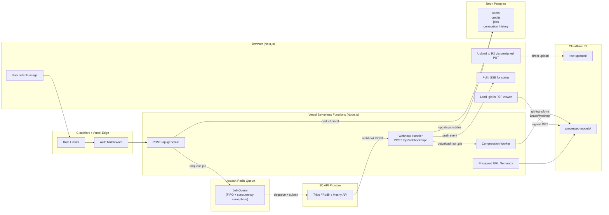
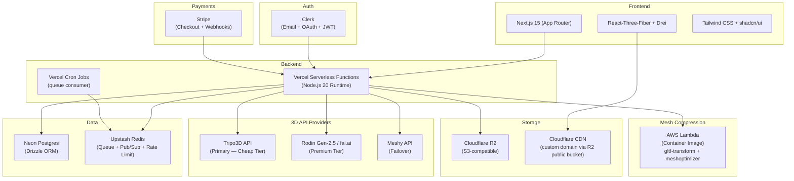
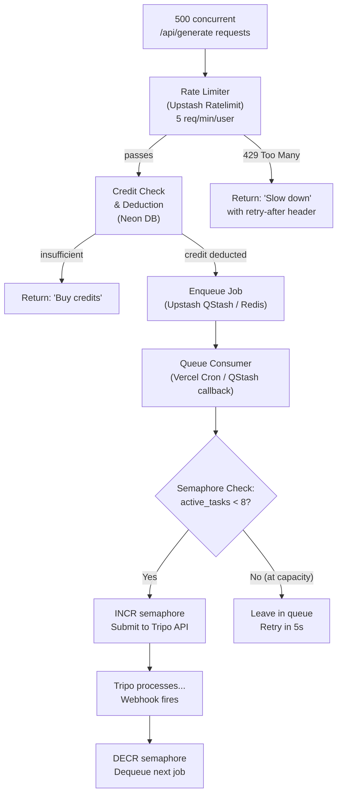

> **Superseded (2026-11-05).** This document describes the original public SaaS plan. The project is now an internal, invite-only furniture reference-mesh tool built on fal.ai. See README.md.

# Architecture Document
## Image-to-3D SaaS Platform — Serverless Cloud Architecture

**Version:** 0.1 — Draft  
**Date:** 2026-11-01  
**Status:** Research & Design Phase  

---

## 1. API Provider Research & Cost Analysis

### 1.1 Provider Comparison Matrix

| Provider | Cost per Generation (Mesh + Texture) | Speed (Textured Output) | Topology Quality | Webhook Support | API Maturity | Best For |
| :--- | :--- | :--- | :--- | :--- | :--- | :--- |
| **Tripo (v3.1)** | ~\$0.30 (30 credits) | **5–10s draft, ≤ 2 min full** | Clean quad-leaning, minimal cleanup | ✅ Native webhooks | ★★★★★ | **Cheap tier — fast & good enough** |
| **Tripo (P1.0)** | ~\$0.50 (50 credits) | ~60–90s | Higher fidelity, bundled features | ✅ Native webhooks | ★★★★★ | Premium option within Tripo |
| **Meshy (7.1)** | ~\$0.60 (30 credits @ \$0.02/cr) | ~30s standard | Good for organic shapes; may need retopo | ✅ Polling + webhooks | ★★★★☆ | Organic/character assets |
| **Meshy (6-lite)** | ~\$0.10 (5 credits @ \$0.02/cr) | ~15–20s | Lower fidelity; good for previews | ✅ Polling + webhooks | ★★★★☆ | Ultra-cheap drafts |
| **Rodin (Gen-2.5)** | ~\$0.40–\$1.50 (varies by tier) | 5–20s (fast) / 60–120s (high) | **Best production topology** — clean quads, PBR | ✅ Polling-based | ★★★★☆ | **Premium tier — hero assets** |
| **CSM.ai** | ~\$0.15–\$0.20 (subscription) | ~30–60s | Good; PBR textures included | Polling only | ★★★☆☆ | Budget alternative |
| **Luma AI (Genie)** | ⚠️ Deprecated / no public API | N/A | N/A | N/A | ❌ Discontinued | **Do not use** |

### 1.2 Pricing Deep-Dive

#### Tripo3D (Recommended Primary Provider)
```
Credit Rate:   $1.00 = 100 credits
                            
Image-to-3D (v3.1):
  ├── Without texture:     20 credits  → $0.20
  ├── With standard texture: 30 credits → $0.30
  └── With detailed texture: 40 credits → $0.40

Image-to-3D (P1.0 — Latest):
  ├── Without texture:     40 credits  → $0.40
  └── With standard texture: 50 credits → $0.50

Post-Processing Add-ons:
  ├── Smart Low-Poly:      30 credits  → $0.30
  ├── Auto Rigging:        25 credits  → $0.25
  └── Mesh Segmentation:   40 credits  → $0.40
```

#### Meshy.ai (Secondary/Fallback Provider)
```
Credit Rate:   ~$0.02/credit (Pro plan: $20/mo → 1,000 credits)

Image-to-3D (Meshy-7.1):
  ├── Mesh only:           20 credits  → $0.40
  ├── Mesh + 2K texture:   30 credits  → $0.60
  └── + Ultra 2K/4K geo:   +5 credits  → +$0.10

Image-to-3D (Meshy-6-lite):
  └── Mesh + texture:       5 credits  → $0.10
```

#### Hyper3D Rodin (Premium Tier)
```
Subscription:  Business $120/mo (full API access, 120 RPM)
Per-Generation via fal.ai:  ~$0.40/run (standard)
  ├── High Quality:        0.5 credits → ~$0.75
  ├── Extreme High:        1.0 credit  → ~$1.50
  └── + 4K/12K textures:   +0.5–2.0 credits additional
```

### 1.3 Tier Recommendations

> [!IMPORTANT]
> **Cheap Tier (Web Preview):** Use **Tripo v3.1** with standard texture.  
> - Cost: **~\$0.30/generation**  
> - Speed: **≤ 2 minutes** (often < 30s)  
> - Output: Clean, lightweight mesh; good enough for web preview and casual use.
>
> **Premium Tier (High-Poly/Hero):** Use **Rodin Gen-2.5 High** via fal.ai or direct API.  
> - Cost: **~\$0.75–\$1.50/generation**  
> - Speed: **60–120 seconds**  
> - Output: Production-grade topology, PBR texture maps, minimal manual cleanup.
>
> **Fallback:** If either primary provider experiences downtime, hot-swap to **Meshy-7.1** at \$0.60/gen.

### 1.4 Rate Limits & Concurrency Caps

| Provider | Max Concurrent Tasks | Request Rate Limit | Behavior on Exceed |
| :--- | :--- | :--- | :--- |
| **Tripo (v3.1 — H Series)** | ~10 parallel tasks | 10 QPS (upload) | HTTP 429 (code 2000) |
| **Tripo (P1.0 — P Series)** | ~5 parallel tasks | 10 QPS (upload) | HTTP 429 (code 2000) |
| **Meshy (Pro)** | 10 concurrent queue tasks | 20 RPS | HTTP 429 `RateLimitExceeded` |
| **Meshy (Premium)** | 30 concurrent queue tasks | 20 RPS | HTTP 429 `NoMoreConcurrentTasks` |
| **Rodin (Business)** | 120–240 RPM | Per-tier limits | Varies |

> [!CAUTION]
> **If your site goes viral and 500 users hit the API at once:**  
> With Tripo v3.1, you can only run **10 tasks in parallel**. The other 490 requests will receive HTTP 429 errors. You **must** implement a server-side job queue (see Section 2.3).

---

## 2. Cloud Architecture & Data Flow

### 2.1 System Overview

The architecture follows a **serverless event-driven pattern** with four distinct phases: Upload → Generate → Compress → Deliver.



### 2.2 Step-by-Step Data Flow Lifecycle

#### Phase 1 — Image Upload (Browser → Storage)

```
┌──────────┐         ┌─────────────────────┐         ┌──────────┐
│  Browser  │───(1)──▶│  POST /api/upload    │───(2)──▶│  Neon DB  │
│           │         │  (Serverless Fn)     │         │ (validate │
│           │         │                     │         │  credits) │
│           │◀──(3)───│ Returns presigned    │         └──────────┘
│           │         │ PUT URL + job_id    │
│           │         └─────────────────────┘
│           │
│           │───(4)──▶ PUT <presigned-url>  ──────────▶ Cloudflare R2
│           │         (direct upload, no                raw-uploads/
│           │          serverless function               {job_id}.jpg
│           │          in the data path)
└──────────┘
```

1. Frontend calls `POST /api/upload` with metadata (file name, size, tier selection).
2. Backend validates user auth, checks credit balance ≥ 1, and creates a `job` row in Neon (`status: pending`).
3. Backend generates a **presigned PUT URL** for R2 (5-minute expiry, restricted to exact file size + content type).
4. Browser uploads the image **directly** to R2 — the serverless function never touches the binary data.

> [!TIP]
> **Why presigned uploads?** Serverless functions have payload limits (Vercel: 4.5 MB on Hobby, 100 MB on Pro). Presigned PUT URLs bypass this entirely, letting the browser stream directly to storage. This also avoids paying for function execution time during large uploads.

#### Phase 2 — Job Submission (Backend → 3D API)

```
┌──────────────────┐       ┌────────────────┐       ┌─────────────┐
│ POST /api/upload  │──(5)─▶│ Upstash Redis  │──(6)─▶│ Queue Worker │
│ (after upload     │       │ Queue          │       │ (Serverless  │
│  confirmation)    │       │                │       │  Function)   │
└──────────────────┘       └────────────────┘       │              │
                                                     │──(7)─▶ Tripo API
                                                     │   POST /v3/tasks
                                                     │   { image_url: R2_signed_url,
                                                     │     model_version: "v3.1",
                                                     │     texture: true }
                                                     │
                                                     │──(8)─▶ Neon DB
                                                     │   UPDATE jobs SET
                                                     │   provider_task_id = "...",
                                                     │   status = "submitted"
                                                     └──────────────┘
```

5. After the browser confirms upload, backend enqueues a job message into **Upstash Redis** (via `@upstash/qstash` or raw `LPUSH`).
6. A queue consumer (cron-triggered or QStash-pushed serverless function) dequeues jobs, respecting a **concurrency semaphore** (max 8 of 10 allowed Tripo slots — reserve 2 for headroom).
7. Worker submits the image URL to Tripo (or Rodin) API, including a `webhook_url` pointing back to `https://yourapp.com/api/webhook/tripo`.
8. Worker stores the `provider_task_id` in the DB and sets `status = "submitted"`.

#### Phase 3 — Webhook & Compression (3D API → Backend → Storage)

```
┌─────────────┐       ┌──────────────────────┐       ┌──────────────┐
│ Tripo API    │──(9)─▶│ POST /api/webhook/   │──(10)▶│ Compression  │
│ (job done)   │       │ tripo                │       │ Worker       │
│              │       │                      │       │ (Lambda/     │
│ Payload:     │       │ 1. Verify HMAC sig   │       │  Cloud Run)  │
│ { task_id,   │       │ 2. Check idempotency │       │              │
│   status,    │       │ 3. Fetch raw .glb    │       │ gltf-transform│
│   model_url }│       │    from provider CDN │       │ → dedup()    │
└─────────────┘       │ 4. Trigger compress  │       │ → prune()    │
                       └──────────────────────┘       │ → simplify() │
                                                      │   (ratio 0.5)│
                                                      │ → draco()    │
                                                      │              │
                                                      │──(11)▶ R2    │
                                                      │ processed-   │
                                                      │ models/      │
                                                      │ {job_id}.glb │
                                                      │              │
                                                      │──(12)▶ Neon  │
                                                      │ UPDATE jobs  │
                                                      │ SET status = │
                                                      │ "completed", │
                                                      │ file_size,   │
                                                      │ poly_count   │
                                                      └──────────────┘
```

9. Tripo sends a signed webhook `POST` to your endpoint with `task.completed` or `task.failed`.
10. Webhook handler verifies the HMAC-SHA256 signature (`Tripo-Webhook-Signature: t=<ts>,v1=<sig>`), checks idempotency key (`Tripo-Webhook-Delivery`), and downloads the raw `.glb` from the provider's CDN URL.
11. Compression worker runs `gltf-transform` pipeline: `dedup()` → `prune()` → `simplify(ratio: 0.5)` → `draco()`. Uploads the optimized `.glb` to R2 `processed-models/`.
12. DB updated with `status = "completed"`, compressed file size, and polygon count.

> [!WARNING]
> **Compression cannot run inside a standard Vercel Serverless Function** for large meshes. `gltf-transform` with `meshoptimizer` WASM needs ≥ 1 GB RAM and up to 30s for a 50 MB input. Options:
> - **Vercel Functions (Pro):** 60s timeout, configurable memory up to 3 GB. May work for most meshes.
> - **AWS Lambda (container image):** 10 GB `/tmp`, 15-min timeout, 10 GB RAM. **Recommended for heavy compression.**
> - **Google Cloud Run:** Up to 32 GB RAM, 60-min timeout. Best for extreme cases.

#### Phase 4 — Frontend Update & Rendering

```
┌──────────────────┐       ┌──────────┐       ┌──────────────┐
│ Webhook Handler   │──(13)▶│ Upstash  │──(14)▶│ Browser      │
│ (after compress)  │       │ Redis    │       │ (SSE/WS)     │
│                   │       │ Pub/Sub  │       │              │
│ PUBLISH channel:  │       │          │       │ EventSource: │
│ job:{job_id}     │       │          │       │ /api/events/ │
│ { status, url }   │       │          │       │ {job_id}     │
└──────────────────┘       └──────────┘       │              │
                                               │──(15)▶ R3F   │
                                               │ <Canvas>     │
                                               │ useGLTF()    │
                                               │ loads .glb   │
                                               │ from R2 CDN  │
                                               └──────────────┘
```

**Two approaches for pushing updates to the frontend:**

| Method | Pros | Cons | Recommendation |
| :--- | :--- | :--- | :--- |
| **SSE (Server-Sent Events)** | Simple, HTTP/1.1 compatible, auto-reconnect, works through CDN | Unidirectional, connection held open on serverless (costs \$) | ✅ **Recommended for MVP** |
| **WebSockets** | Bidirectional, low latency | Requires persistent connection (hard on serverless), needs dedicated infra | Better at scale; use Ably/Pusher |
| **Short Polling** | Trivially simple, stateless | Wasteful, poor UX (laggy updates) | Acceptable fallback |

**Recommended MVP approach:** Use **Upstash Redis Pub/Sub** + a thin SSE endpoint:
1. Webhook handler publishes `{status, modelUrl}` to Redis channel `job:{job_id}`.
2. Frontend opens `EventSource` to `GET /api/events/{job_id}`.
3. SSE serverless function subscribes to Redis channel and streams events to the client.
4. On `status: completed`, frontend calls `useGLTF(modelUrl)` to load the model in React-Three-Fiber.

**At scale (> 10K concurrent users):** Migrate to a managed WebSocket service like **Ably**, **Pusher**, or **Soketi** (self-hosted Pusher protocol on Fly.io).

---

## 3. Full Tech Stack Recommendations (100% Cloud/Serverless)

### 3.1 Architecture Overview



### 3.2 Component Breakdown

#### Frontend

| Layer | Choice | Rationale |
| :--- | :--- | :--- |
| **Framework** | **Next.js 15** (App Router) | Server Components for SEO, API routes co-located, Vercel-native deployment, streaming support |
| **3D Rendering** | **React-Three-Fiber (R3F)** + **@react-three/drei** | Declarative Three.js for React; `useGLTF()` loads `.glb` with Draco decoder; `OrbitControls`, `Environment`, `ContactShadows` out of the box |
| **3D Format Loader** | **three/examples/jsm/loaders/GLTFLoader** + **DRACOLoader** (via drei) | Must include the Draco WASM decoder (`draco3dgltf/`) for compressed `.glb` files |
| **UI** | **Tailwind CSS** + **shadcn/ui** | Rapid prototyping, accessible components, dark mode |
| **State** | **Zustand** | Lightweight store for job status, credit balance, viewer state |
| **File Upload** | **Uppy** or custom `<input type="file">` + presigned PUT | Client-side image resize via `canvas` API before upload |

#### Backend (Serverless)

| Layer | Choice | Rationale |
| :--- | :--- | :--- |
| **Compute** | **Vercel Serverless Functions** (Node.js 20) | Zero-config deployment with Next.js API routes; 60s timeout on Pro (enough for API orchestration) |
| **Job Queue** | **Upstash QStash** or **Upstash Redis Lists** | Serverless-native message queue; QStash provides HTTP-based delivery with retries, deduplication, and delayed messages. No always-on infra. |
| **Concurrency Control** | **Redis-based distributed semaphore** (`SETNX` / `INCR` with TTL) | Limits outbound calls to Tripo/Rodin to stay under their concurrent task caps (e.g., max 8) |
| **Webhook Handler** | Vercel Serverless Function at `/api/webhook/[provider]` | Signature verification, idempotency check, triggers compression |
| **Cron** | **Vercel Cron** (`vercel.json`) | Periodic job: clean up stale/orphaned jobs > 24h old; check provider credit balances |

#### Mesh Compression Worker

| Layer | Choice | Rationale |
| :--- | :--- | :--- |
| **Compute** | **AWS Lambda** (Container Image, arm64 Graviton) | 10 GB `/tmp`, 10 GB RAM, 15-min timeout. Handles heavy `.glb` files that would timeout on Vercel. |
| **Toolchain** | **`gltf-transform`** (Node.js) | Scriptable pipeline: `dedup()` → `prune()` → `simplify()` (via `meshoptimizer` WASM) → `draco()` compression |
| **Trigger** | Invoked by Vercel webhook handler via **AWS Lambda Function URL** (HTTPS, no API Gateway needed) | Async invocation; Lambda returns immediately, processes in background |
| **Output** | Uploads optimized `.glb` directly to **Cloudflare R2** | Uses S3-compatible SDK with R2 endpoint |

```javascript
// Compression pipeline pseudocode (Lambda handler)
import { NodeIO } from '@gltf-transform/core';
import { ALL_EXTENSIONS } from '@gltf-transform/extensions';
import { dedup, prune, simplify, draco } from '@gltf-transform/functions';
import { MeshoptSimplifier } from 'meshoptimizer';

export async function handler(event) {
  const { jobId, rawGlbUrl, targetRatio = 0.5 } = JSON.parse(event.body);

  // 1. Download raw .glb from provider CDN
  const rawBuffer = await fetch(rawGlbUrl).then(r => r.arrayBuffer());
  const inputPath = `/tmp/${jobId}-raw.glb`;
  const outputPath = `/tmp/${jobId}-opt.glb`;
  await writeFile(inputPath, Buffer.from(rawBuffer));

  // 2. Process
  await MeshoptSimplifier.ready;
  const io = new NodeIO().registerExtensions(ALL_EXTENSIONS);
  const doc = await io.read(inputPath);

  await doc.transform(
    dedup(),
    prune(),
    simplify({ simplifier: MeshoptSimplifier, ratio: targetRatio }),
    draco({ method: 'edgebreaker', quantizePosition: 14, quantizeNormal: 10 })
  );

  await io.write(outputPath, doc);

  // 3. Upload to R2
  const optimizedBuffer = await readFile(outputPath);
  await uploadToR2(`processed-models/${jobId}.glb`, optimizedBuffer);

  // 4. Callback to Vercel webhook handler
  await fetch(`https://yourapp.com/api/internal/compression-done`, {
    method: 'POST',
    headers: { 'x-internal-secret': process.env.INTERNAL_SECRET },
    body: JSON.stringify({ jobId, fileSize: optimizedBuffer.length })
  });
}
```

#### Database

| Layer | Choice | Rationale |
| :--- | :--- | :--- |
| **Database** | **Neon Postgres** (Serverless) | Scale-to-zero (pays nothing when idle); branch-per-PR for preview deployments; native Vercel integration; connection pooling via `@neondatabase/serverless` driver |
| **ORM** | **Drizzle ORM** | Type-safe, lightweight, SQL-like syntax; generates migrations; works seamlessly with Neon's HTTP driver for serverless |
| **Why not Supabase?** | If you need Auth + Storage + Realtime bundled, Supabase wins. But we're using Clerk (auth), R2 (storage), and Upstash (realtime). Paying \$25/mo for features we don't use is wasteful. Neon is cheaper for a pure DB use case. |

**Schema (Drizzle):**

```typescript
// schema.ts
import { pgTable, uuid, text, integer, timestamp, jsonb, pgEnum } from 'drizzle-orm/pg-core';

export const tierEnum = pgEnum('tier', ['cheap', 'premium']);
export const jobStatusEnum = pgEnum('job_status', [
  'pending', 'uploading', 'queued', 'submitted', 'processing',
  'compressing', 'completed', 'failed', 'refunded'
]);

export const users = pgTable('users', {
  id: uuid('id').defaultRandom().primaryKey(),
  clerkId: text('clerk_id').notNull().unique(),
  email: text('email').notNull(),
  credits: integer('credits').notNull().default(0),
  createdAt: timestamp('created_at').defaultNow(),
});

export const jobs = pgTable('jobs', {
  id: uuid('id').defaultRandom().primaryKey(),
  userId: uuid('user_id').references(() => users.id).notNull(),
  status: jobStatusEnum('status').notNull().default('pending'),
  tier: tierEnum('tier').notNull(),
  provider: text('provider').notNull(),          // 'tripo' | 'rodin' | 'meshy'
  providerTaskId: text('provider_task_id'),
  inputImageUrl: text('input_image_url'),         // R2 presigned URL
  rawModelUrl: text('raw_model_url'),             // Provider CDN URL
  processedModelUrl: text('processed_model_url'), // R2 URL
  rawFileSize: integer('raw_file_size'),           // bytes
  processedFileSize: integer('processed_file_size'),
  polyCount: integer('poly_count'),
  errorMessage: text('error_message'),
  providerMeta: jsonb('provider_meta'),           // Full provider response
  createdAt: timestamp('created_at').defaultNow(),
  completedAt: timestamp('completed_at'),
});

export const creditTransactions = pgTable('credit_transactions', {
  id: uuid('id').defaultRandom().primaryKey(),
  userId: uuid('user_id').references(() => users.id).notNull(),
  amount: integer('amount').notNull(),             // +10, -1, etc.
  type: text('type').notNull(),                    // 'purchase' | 'generation' | 'refund'
  jobId: uuid('job_id').references(() => jobs.id),
  stripePaymentId: text('stripe_payment_id'),
  createdAt: timestamp('created_at').defaultNow(),
});
```

#### Object Storage

| Layer | Choice | Rationale |
| :--- | :--- | :--- |
| **Storage** | **Cloudflare R2** | **Zero egress fees** — 3D models are large (5–50 MB); at scale, S3 egress (\$0.09/GB) would be ruinous. R2 is S3-API compatible (use AWS SDK). Permanent free tier: 10 GB storage, 10M reads/mo. |
| **CDN** | **R2 Custom Domain** (via Cloudflare) or **Cloudflare CDN** | Automatic edge caching for processed models. Set `Cache-Control: public, max-age=31536000, immutable` on processed `.glb` files (content-addressed by job ID). |
| **Presigned URLs** | Generated server-side using `aws4fetch` or `@aws-sdk/s3-request-presigner` | PUT URLs: 5-min expiry, restricted content type. GET URLs: 1-hour expiry. |

**R2 Bucket Structure:**
```
image-to-3d-bucket/
├── raw-uploads/          # Original user images
│   └── {job_id}.jpg
├── processed-models/     # Compressed .glb files (served to users)
│   └── {job_id}.glb
├── raw-models/           # Uncompressed provider outputs (retained 7 days, then lifecycle-deleted)
│   └── {job_id}-raw.glb
└── thumbnails/           # Auto-generated preview images
    └── {job_id}.webp
```

#### Auth, Payments & Rate Limiting

| Layer | Choice | Rationale |
| :--- | :--- | :--- |
| **Auth** | **Clerk** | Drop-in React components, JWT-based, Vercel-native, handles email + Google + GitHub OAuth. Webhook on user creation syncs to Neon. |
| **Payments** | **Stripe Checkout** + **Stripe Webhooks** | Hosted checkout page (PCI-compliant, zero frontend payment code). `checkout.session.completed` webhook adds credits to DB. |
| **Rate Limiting** | **Upstash Ratelimit** (`@upstash/ratelimit`) | Sliding-window rate limiter backed by serverless Redis. Apply to `/api/generate` endpoint: e.g., 5 requests/minute per user, 60 requests/minute global. |

---

## 4. The "Unknown Unknowns" — Crucial API Traps

### 4.1 Rate Limiting & Concurrency: The Viral Scenario

**The Problem:** Your site goes viral. 500 users click "Generate" simultaneously. Tripo allows 10 concurrent tasks. You get 490 HTTP 429 errors, lose user trust, and potentially get your API key suspended.

**The Solution: Server-Side Job Queue with Distributed Semaphore**



**Implementation details:**

```typescript
// Distributed semaphore using Upstash Redis
const PROVIDER_LIMITS = {
  tripo_v31: 8,   // Reserve 2 of Tripo's 10 slots for headroom
  tripo_p10: 4,   // Reserve 1 of 5 slots
  rodin: 10,
};

async function acquireSlot(provider: string): Promise<boolean> {
  const key = `semaphore:${provider}`;
  const current = await redis.incr(key);
  if (current > PROVIDER_LIMITS[provider]) {
    await redis.decr(key);
    return false; // At capacity
  }
  await redis.expire(key, 300); // TTL safety net (5 min)
  return true;
}

async function releaseSlot(provider: string): Promise<void> {
  await redis.decr(`semaphore:${provider}`);
}
```

### 4.2 Mesh Decimation & File Size: The Mobile Crasher

**The Problem:** Tripo and Rodin can return meshes with 200K–500K+ polygons and raw file sizes of 20–50 MB. Loading a 50 MB `.glb` on a mobile browser with 2 GB RAM **will crash the tab** or render at < 5 FPS.

**Target Budgets:**

| Platform | Max File Size | Max Polygon Count | Compression |
| :--- | :--- | :--- | :--- |
| Desktop (modern GPU) | ≤ 15 MB | ≤ 200K triangles | Draco (quantize 14-bit position) |
| Mobile (mid-range) | ≤ 5 MB | ≤ 50K triangles | Draco + aggressive simplification (ratio 0.25) |
| AR (USDZ/WebXR) | ≤ 10 MB | ≤ 100K triangles | USDZ-native compression |

**The Solution: Two-Pass Compression Pipeline**

```typescript
// In the Lambda compression worker:
async function compressForPlatforms(jobId: string, rawGlb: Buffer) {
  const io = new NodeIO().registerExtensions(ALL_EXTENSIONS);
  const doc = await io.readBinary(new Uint8Array(rawGlb));
  await MeshoptSimplifier.ready;

  // Pass 1: Desktop-quality (default delivery)
  const desktopDoc = doc.clone();
  await desktopDoc.transform(
    dedup(), prune(),
    simplify({ simplifier: MeshoptSimplifier, ratio: 0.5 }),  // 50% reduction
    draco({ quantizePosition: 14, quantizeNormal: 10 })
  );
  const desktopGlb = await io.writeBinary(desktopDoc);
  await uploadToR2(`processed-models/${jobId}/desktop.glb`, desktopGlb);

  // Pass 2: Mobile-quality (aggressive)
  const mobileDoc = doc.clone();
  await mobileDoc.transform(
    dedup(), prune(),
    simplify({ simplifier: MeshoptSimplifier, ratio: 0.15 }),  // 85% reduction
    draco({ quantizePosition: 12, quantizeNormal: 8 })
  );
  const mobileGlb = await io.writeBinary(mobileDoc);
  await uploadToR2(`processed-models/${jobId}/mobile.glb`, mobileGlb);
}
```

The frontend detects the device and loads the appropriate variant:

```typescript
// In the React-Three-Fiber viewer component
const isMobile = /Android|iPhone|iPad/.test(navigator.userAgent) 
  || window.innerWidth < 768;
const modelUrl = isMobile
  ? `/api/model/${jobId}?variant=mobile`
  : `/api/model/${jobId}?variant=desktop`;

const { scene } = useGLTF(modelUrl);
```

> [!NOTE]
> **Texture compression matters too.** Beyond geometry, textures are often the largest contributor to file size. Consider:
> - Convert PNG/JPEG textures to **KTX2** (GPU-compressed) using `gltf-transform`'s `textureCompress()`.
> - Target **1K textures** for mobile, **2K** for desktop.
> - `gltf-transform` can do this: `textureCompress({ encoder: sharp, targetFormat: 'webp', resize: [1024, 1024] })`.

### 4.3 Credit Fraud: Protecting Your API Budget

**Attack vectors and defenses:**

| Attack Vector | Impact | Defense |
| :--- | :--- | :--- |
| **Bot spamming `/api/generate`** | Burns all your Tripo credits; \$100s/hour | Per-user rate limit (5/min) + global rate limit (60/min) + CAPTCHA after 3rd generation in a session |
| **Account farming** (create 100 free accounts) | Drains free-tier credits | Require email verification via Clerk; tie to phone number or payment method for free credits; use Clerk's bot detection |
| **Replaying presigned URLs** | Re-uploads / re-downloads bypass credit system | Short expiry (5 min PUT, 1 hr GET); one-time-use via R2 upload condition + DB check |
| **Direct API endpoint abuse** (leaked API key) | Attacker calls Tripo directly with your key | **Never expose the 3D API key to the frontend.** All calls go through your backend. Rotate keys monthly. Set Tripo IP allowlist if supported. |
| **Credit manipulation** (race condition) | User triggers 10 generations in parallel, all pass credit check before any deduct | **Atomic credit deduction:** `UPDATE users SET credits = credits - 1 WHERE id = $1 AND credits >= 1 RETURNING credits`. If `RETURNING` yields no rows, reject. This is a single atomic SQL statement — no race condition. |

**Defense-in-depth stack:**

```typescript
// /api/generate — rate limiting + credit deduction
import { Ratelimit } from '@upstash/ratelimit';
import { Redis } from '@upstash/redis';

const ratelimit = new Ratelimit({
  redis: Redis.fromEnv(),
  limiter: Ratelimit.slidingWindow(5, '60 s'),  // 5 requests per minute per user
  analytics: true,
});

export async function POST(req: Request) {
  const { userId } = auth();  // Clerk JWT

  // 1. Rate limit
  const { success, limit, remaining, reset } = await ratelimit.limit(userId);
  if (!success) {
    return Response.json(
      { error: 'Rate limit exceeded', retryAfter: reset },
      { status: 429, headers: { 'Retry-After': String(reset) } }
    );
  }

  // 2. Atomic credit deduction (prevents race conditions)
  const [result] = await db.execute(sql`
    UPDATE users
    SET credits = credits - 1
    WHERE clerk_id = ${userId} AND credits >= 1
    RETURNING credits
  `);
  if (!result) {
    return Response.json({ error: 'Insufficient credits' }, { status: 402 });
  }

  // 3. Enqueue job (not direct API call — goes through queue)
  await qstash.publishJSON({
    url: `${process.env.BASE_URL}/api/queue/process`,
    body: { userId, jobId: crypto.randomUUID(), tier: 'cheap' },
    retries: 3,
    deduplicationId: `gen-${userId}-${Date.now()}`,  // Prevent duplicate submissions
  });

  return Response.json({ jobId, status: 'queued', creditsRemaining: result.credits });
}
```

### 4.4 Additional "Unknown Unknowns"

#### 4.4.1 Provider CDN URL Expiration
> [!CAUTION]
> Tripo's `output.model_url` (the raw `.glb` download link) **expires after a fixed window** (typically 24–48 hours). If your webhook handler fails and you retry later, the URL may be dead. **Always download and store the raw model in your own R2 bucket immediately upon webhook receipt.** Never rely on the provider URL for long-term storage.

#### 4.4.2 Provider Output Format Inconsistency
Different providers return different `.glb` internals:
- **Tripo:** Single mesh, UV-mapped, PBR metallic-roughness material. Generally clean.
- **Meshy:** Sometimes embeds multiple meshes per file (especially with `generate_parts`). Your viewer must handle multi-mesh scenes.
- **Rodin:** May return separate texture files (base color, normal, roughness) alongside the mesh. Ensure your `gltf-transform` pipeline handles external texture references.

**Mitigation:** Build a **provider adapter layer** that normalizes outputs:
```typescript
interface NormalizedOutput {
  glbBuffer: Buffer;
  polyCount: number;
  textureResolution: [number, number];
  materialType: 'pbr' | 'unlit';
}

function normalizeTripoOutput(raw: Buffer): NormalizedOutput { ... }
function normalizeRodinOutput(raw: Buffer): NormalizedOutput { ... }
function normalizeMeshyOutput(raw: Buffer): NormalizedOutput { ... }
```

#### 4.4.3 CORS and R2 Presigned URL Gotchas
Cloudflare R2 presigned PUT URLs require proper CORS configuration on the bucket, or the browser will block the direct upload. You must set a CORS policy on the R2 bucket:

```json
[
  {
    "AllowedOrigins": ["https://yourdomain.com"],
    "AllowedMethods": ["PUT", "GET"],
    "AllowedHeaders": ["Content-Type", "Content-Length"],
    "ExposeHeaders": ["ETag"],
    "MaxAgeSeconds": 3600
  }
]
```

#### 4.4.4 Provider Bill Shock Alerts
Set up a **credit balance monitor** that alerts you (Slack, PagerDuty) when your provider credit balance drops below a threshold:

```typescript
// Vercel Cron: runs every hour
// cron: "0 * * * *"
export async function GET() {
  const balance = await tripoApi.getBalance();
  if (balance.credits < 500) {
    await slack.send(`⚠️ Tripo credits low: ${balance.credits} remaining (~${balance.credits * 0.01} USD)`);
  }
  // Also check: Tripo supports a `balance.low` webhook event
}
```

#### 4.4.5 Idempotency & Exactly-Once Processing
Webhooks can be delivered **more than once** (network retries). Without idempotency, you'll compress the same model twice and potentially double-deduct or double-refund credits.

**Solution:** Store the webhook delivery ID in Redis with a short TTL:
```typescript
const deliveryId = req.headers.get('Tripo-Webhook-Delivery');
const alreadyProcessed = await redis.set(`webhook:${deliveryId}`, '1', { nx: true, ex: 86400 });
if (!alreadyProcessed) {
  return new Response('Already processed', { status: 200 });
}
```

#### 4.4.6 Cold Start Latency on Compression Lambda
The first invocation of an AWS Lambda container image (with `meshoptimizer` WASM) takes 3–8 seconds to cold-start. For a user waiting 90 seconds for their model, this is acceptable. But at scale:
- Use **Provisioned Concurrency** (1–2 instances) to keep the Lambda warm during peak hours.
- Or use **Lambda SnapStart** (if Node.js support is available in your region).

---

## 5. Deployment & Infrastructure

### 5.1 Environment Setup

| Component | Service | Region | Notes |
| :--- | :--- | :--- | :--- |
| Frontend + API Routes | Vercel (Pro) | `iad1` (US East) | Auto-scales, 60s function timeout |
| Database | Neon Postgres | US East (AWS) | Same region as Vercel for low latency |
| Cache + Queue | Upstash Redis | US East | Global replication available |
| Object Storage | Cloudflare R2 | Auto (nearest POP) | Zero egress; S3-compatible |
| Compression | AWS Lambda | `us-east-1` | Container image, arm64, 2048 MB RAM |
| Auth | Clerk | Global (edge) | — |
| Payments | Stripe | Global | — |
| Monitoring | Vercel Analytics + Sentry | — | Error tracking + performance |

### 5.2 Cost Projection (1,000 Generations/Month)

| Item | Unit Cost | Monthly Cost |
| :--- | :--- | :--- |
| Tripo API (cheap tier) × 800 | \$0.30/gen | \$240 |
| Rodin API (premium tier) × 200 | \$1.00/gen | \$200 |
| Vercel Pro | \$20/mo flat | \$20 |
| Neon Postgres (Launch) | ~\$5–\$15/mo | \$10 |
| Upstash Redis (Pay-as-you-go) | ~\$0.20/100K commands | \$5 |
| Cloudflare R2 (50 GB stored, 500K reads) | \$0.75 storage + \$0.18 reads | \$1 |
| AWS Lambda (1,000 invocations × 30s × 2 GB) | ~\$0.80 | \$1 |
| Clerk (Pro, 1K MAU) | \$25/mo | \$25 |
| Stripe (2.9% + \$0.30 per txn × ~50 txns) | ~\$1.75/txn avg | \$88 |
| **Total COGS** | | **~\$590/mo** |

> [!TIP]
> At \$590/mo COGS for 1,000 generations, you need to price credit packs such that average revenue per generation exceeds **\$0.59**. A suggested pricing model:
> - 10 credits → \$9.99 (\$1.00/gen — 70% margin on cheap tier)
> - 50 credits → \$39.99 (\$0.80/gen)
> - 200 credits → \$129.99 (\$0.65/gen)
